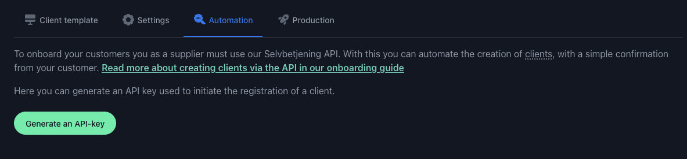

# Getting started

This repository contains three sample implementations for using the [Selvbetjening for HelseID API](https://api.selvbetjening.test.nhn.no/):
1. Create HelseID clients
2. Updating HelseID clients
3. Running a conformance test

Full API docs can be found in [Selvbetjening for HelseID](https://selvbetjening.test.nhn.no/docs/api).

# Create HelseID clients
A client template must be created in [Selvbetjening for HelseID ](https://selvbetjening.test.nhn.no/).

For this sample implementation you need to enable user login and enable support for refresh tokens. The redirect URI should be set to `http://localhost:1337/callback` when using the default config.

After the client system has been created, navigate to the 'Automation' tab, and generate an API key:



Move into [appsettings.json](https://github.com/NorskHelsenett/Selvbetjening.Samples/blob/main/ClientRegistrationExample/appsettings.json), and paste the API key. This key is used for authenticating against the [client drafts endpoint](https://ext.selvbetjening.test.nhn.no).

```
{
  ...
  "Selvbetjening": {
    ...
    "ClientDraftApiKeyHeader": "api-key",
    "ClientDraftApiKey": "[PASTE here]"
  }
  ...
}
```

## Creating the client draft

Follow the sample code in [ClientRegistrationExample](https://github.com/NorskHelsenett/Selvbetjening.Samples/tree/main/ClientRegistrationExample).

1. Create the client draft using the `client-drafts` endpoint
2. Direct the end user to Selvbetjening for HelseID: `/confirm-client/<client_id>`, where `<client_id>` is the ID of the client draft
3. Check the status of the client's access to the specified scopes
4. Authenticate the end user and request access tokens for the specified APIs
5. You're ready to go

# Updating HelseID clients

Follow the sample code in [ClientUpdateExample](https://github.com/NorskHelsenett/Selvbetjening.Samples/tree/main/ClientUpdateExample).

There are two separate endpoints for updating the client:

1. Updating the client secret
2. Updating the rest of the client configuration

The update operation will affect all properties in the payload as submitted. If a property is set to null in the payload, the property **will not** be ignored and will be updated in the client configuration.

### Example for redirect uris:

If you want to add a redirect uri, you also need to submit the previous redirect uris, along with the rest of the relevant data for the client configuration.  
If you want to delete a redirect uri, remove it from the array and call the update endpoint with the rest of the data.  
If you set redirect uris to be null, the update will fail if the client system isn't configured to use the same redirect uris for all client configurations.

# Running a conformance test

A conformance test checks that your software authenticates the way the HelseID security profile
requires. The session hands out an authority URI of its own; your client authenticates against that
instead of HelseID, and the service examines what it saw. Nothing is simulated — the token request
your software makes is the thing being tested.

[ConformanceTestExample](https://github.com/NorskHelsenett/Selvbetjening.Samples/tree/main/ConformanceTestExample)
covers a machine-to-machine client.

## Before you start

You need three things, and they have to belong together:

1. A **client system** in Selvbetjening for HelseID.
2. An **API key for conformance testing**, generated from the `Samsvarstesting` tab of that client
   system. This is a different key from the one on the `Automation` tab.
3. An existing **HelseID client created from that same client system**, and its private key.
   Starting a session for a client belonging to a different client system is rejected.

Put the values in `appsettings.Local.json` next to `appsettings.json`, which is gitignored:

```
{
  "Selvbetjening": {
    "ConformanceTestApiKey": "[PASTE here]"
  },
  "Client": {
    "ClientId": "[PASTE here]",
    "Jwk": "[PASTE the private JWK here]",
    "Scopes": [ "[PASTE each scope you use here]" ]
  }
}
```

## What the sample does

1. Starts a session with `POST /v1/conformance-test-sessions`, authenticating with the `api-key`
   header, and receives a session id and the authority URI to use
2. Requests an access token with the client credentials grant against that authority — this is the
   step being examined. Tokens issued by a session cannot be used against APIs. The session accepts
   requests that HelseID would reject, so receiving a token does not mean the request was correct
3. Ends the session with `POST /v1/conformance-test-sessions/{sessionId}/end`, which returns the
   verdict and the checks behind it
4. Prints each request the test observed, with the outcome of every check

`Program.cs` also has two examples for endpoints that are not required. They are off by default;
set the constant at the top of the file to `true` to run one:

- `EnableResetExample` resets the session with `POST /v1/conformance-test-sessions/{sessionId}/reset`,
  runs the client again and ends the session. The session id and authority URI stay the same, so
  you can test again, for example after fixing your client, without changing its configuration
- `EnableGetExample` fetches the session with `GET /v1/conformance-test-sessions/{sessionId}`, for
  reading the results at a later time. Sessions are not stored forever

A warning prevents a test from passing, not only a failure. The same results are shown on the
client system's `Samsvarstesting` tab in Selvbetjening for HelseID.
